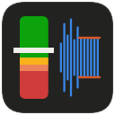
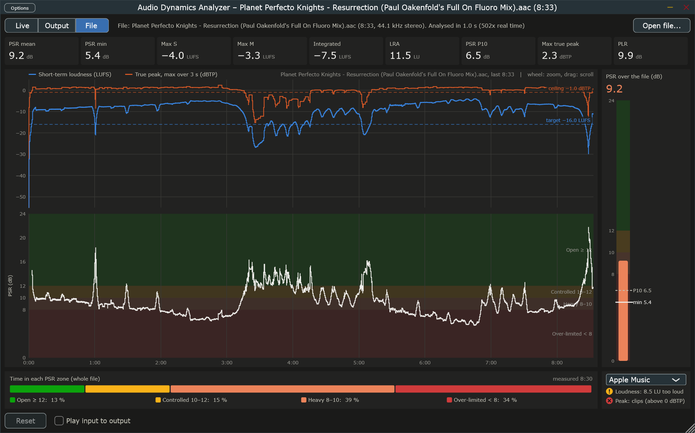

#  Audio Dynamics Analyzer (ADA)

Find out how squashed a master is. ADA measures loudness and dynamics to **ITU-R BS.1770** and **EBU R128**. The measurements are:

* **PSR** (peak-to-short-term ratio): how hard the transients are limited, second by second.
* **PLR** (peak-to-loudness ratio): the dynamic headroom of the whole track.
* **Integrated loudness** (LUFS), **loudness range** (LRA), and **true peak** (dBTP).



*The standalone app (also a VST3 plugin) after analysing an 8½-minute trance track in one second: integrated −7.5 LUFS, PSR mostly in the "heavy" and "over-limited" zones, peaks above 0 dBTP. Against Apple Music's −16 LUFS it would be turned down by 8.5 dB.*


*The same kind of profile as a plot from the Python scanner (`ada-plot`).*

## Download

Ready-to-use Windows builds (VST3 plugin and standalone app, 64-bit) are on the **[Releases page](https://github.com/klangme1ster/audio-dynamics-analyzer/releases)**. Unzip, copy the `.vst3` folder to `C:\Program Files\Common Files\VST3`, or just run the `.exe`; the zip's `INSTALL.txt` has the details. The files are not code-signed, so Windows may warn on first start (*More info → Run anyway*).

## Status

| Stage | What | State |
|---|---|---|
| 1 | Python reference engine, batch scanner `ada-scan`, plotter `ada-plot` | ✅ working |
| 2 | C++20 / JUCE 8 VST3 plugin + standalone app (drag-and-drop analysis) | ✅ live metering with history, PSR meter and zone bar; file analysis matching the Python reference (WAV/AIFF/FLAC, and M4A on Windows); measuring what Windows plays (standalone); delivery target checks (Spotify, Apple Music, YouTube, Tidal, EBU R 128, ATSC A/85, custom) |

The Python engine is the numerical reference. The C++ engine is a port of it and must match it within fixed tolerances (spec test ADA-PARITY).

All phases of the [implementation plan](IMPLEMENTATION_PLAN.md) are done; v0.2.0 is released and adds surround (5.0, 5.1, 7.1). Still open: MP3 parity between the plugin's and the scanner's decoders, and macOS builds (see [Status and open items](IMPLEMENTATION_PLAN.md#status-and-open-items)).

## Quick start

Requires Python ≥ 3.11.

```bash
git clone git@github.com:klangme1ster/audio-dynamics-analyzer.git
cd audio-dynamics-analyzer
python -m venv .venv
# Windows: .venv\Scripts\activate    macOS/Linux: source .venv/bin/activate
pip install -e "python[dev]"

ada-scan path/to/music --export-csv scan.csv --plot plots
```

It reads WAV, FLAC, AIFF, OGG, MP3 and M4A (AAC / ALAC). This prints a colour-coded table per track, writes a CSV report and saves one dynamics plot per file. See **[USAGE.md](USAGE.md)** for all options, the report fields and how to read the results.

### Updating

New versions can add dependencies (for example PyAV for M4A), so re-run the install after pulling:

```bash
git pull
pip install -e "python[dev]"   # picks up new dependencies
```

## What the numbers mean

| PSR | Zone | Typical material |
|---|---|---|
| ≥ 12 dB | 🟢 Open | Uncompressed transients: acoustic, classical, older masters |
| 10–12 dB | 🟡 Controlled | Punchy commercial dynamics |
| 8–10 dB | 🟠 Heavy | Strong limiting |
| < 8 dB | 🔴 Over-limited | Flattened transients, high distortion risk |

These zones are practical guidance, not a standard. For healthy and problematic ranges of every other value (integrated loudness targets, LRA, PLR, true peak) and the reasons behind them, see [What good values look like](USAGE.md#what-good-values-look-like).

## Building the plugin

Requires a C++20 compiler (on Windows: Visual Studio Build Tools 2026 with the C++ workload) and CMake ≥ 3.24, which the `cpp` extra installs into the venv:

```bash
pip install -e "python[dev,cpp]"
cmake -B build -S . -DCMAKE_BUILD_TYPE=Release
cmake --build build --config Release -j
ctest --test-dir build -C Release        # C++ engine tests
pytest python/tests/test_parity.py       # C++ engine vs. Python reference
```

The first configure downloads JUCE 8. The VST3 and the standalone app end up in `build/src/plugin/AudioDynamicsAnalyzer_artefacts/Release/`. The plugin shows the live readouts, a scrolling PSR/loudness history, a PSR meter and the time per PSR zone (hover over anything for an explanation); drop an audio file on the window (or open one) to analyse it at several hundred times real time, in the standalone app or inside the plugin. See [USAGE.md](USAGE.md#plugin-vst3--standalone) for how it behaves in a DAW.

### Releases

Pushing a version tag builds and publishes a release (`.github/workflows/release.yml`): GitHub builds on Windows, runs the tests (the M4A comparisons only where the build machine's Windows can decode AAC; otherwise the run shows a warning), packs the VST3, the standalone app and `packaging/INSTALL.txt` into a zip and attaches it with `packaging/release-notes.md`. The tag must match the version in `CMakeLists.txt`:

```bash
git tag v0.2.0
git push origin v0.2.0
```

A build without a release can be started by hand under *Actions → Release → Run workflow*; the zip is then attached to the run. Binaries link the C/C++ runtime statically, so users need no Visual C++ redistributable.

### Screenshots

`python python/tools/capture_screenshot.py <audio file> docs/screenshots/file-view.png --size 2000x1250` opens the built standalone app with the file and captures its window (Windows). Retake the screenshots when the GUI changes visibly.

## How it measures

* **K-weighting:** BS.1770 two-stage filter, with coefficients derived for any sample rate.
* **Channels:** mono, stereo, 5.0, 5.1 and 7.1. Channels are weighted as BS.1770 prescribes (surround channels +1.5 dB, LFE left out of the loudness but not the true peak) and their powers added, never folded down; mono counts as one channel, not dual-mono. A multichannel file without layout information is rejected until you supply or confirm the layout ([details](USAGE.md#how-channels-are-measured)).
* **True peak:** the BS.1770 Annex 2 48-tap interpolator. It oversamples 4× at ≤ 48 kHz and 2× at ≤ 96 kHz.
* **PSR alignment:** the peak and the loudness in PSR cover exactly the same 3-second window. Both are computed on a 100 ms grid, and the true-peak filter's delay is compensated.
* **Gating:** BS.1770 gating for integrated loudness and EBU Tech 3342 gating for LRA. Silence and intros are excluded from the PSR statistics.
* **Memory:** files are streamed in chunks, so memory stays bounded for very long recordings. About 100× real-time per CPU core, with files processed in parallel.
* **Validation:** checked against the EBU Tech 3341 and 3342 compliance cases.

The full definitions, tolerances and test matrix are in [PROJECT_SPECIFICATION.md](PROJECT_SPECIFICATION.md). The roadmap is in [IMPLEMENTATION_PLAN.md](IMPLEMENTATION_PLAN.md).

## Repository layout

```
python/ada_core/    engine, K-weighting, true peak, scanner, visualizer
python/tests/       compliance and unit tests (pytest)
python/tools/       EBU test-set installer, C++ table generator
src/, tests/cpp/    C++ engine, JUCE plugin and tests (Stage 2)
```

## Standards

ITU-R BS.1770-5 · EBU R 128 · EBU Tech 3341 · EBU Tech 3342

## License

[MIT](LICENSE). The plugin builds on JUCE; binaries linked against the open-source edition of JUCE are distributed under JUCE's AGPLv3 terms, while this repository's own code remains MIT.
