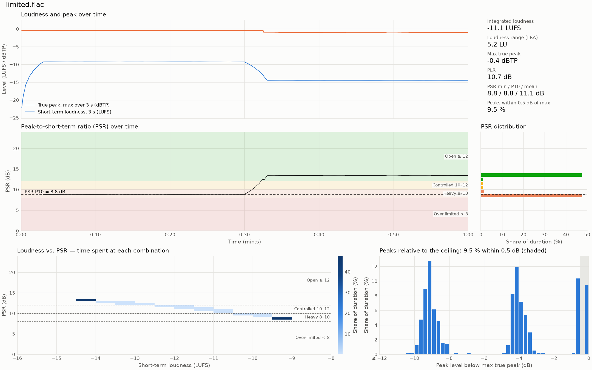

# Audio Dynamics Analyzer (ADA)

Find out how squashed a master is. ADA measures loudness and dynamics to **ITU-R BS.1770** and **EBU R128**. The measurements are:

* **PSR** (peak-to-short-term ratio): how hard the transients are limited, second by second.
* **PLR** (peak-to-loudness ratio): the dynamic headroom of the whole track.
* **Integrated loudness** (LUFS), **loudness range** (LRA), and **true peak** (dBTP).



## Status

| Stage | What | State |
|---|---|---|
| 1 | Python reference engine, batch scanner `ada-scan`, plotter `ada-plot` | ✅ working, 42 tests passing |
| 2 | C++20 / JUCE 8 VST3 plugin + standalone app (drag-and-drop analysis) | 🚧 planned |

The Python engine is the numerical reference. The plugin will be a port of it and must match it within fixed tolerances.

## Quick start

Requires Python ≥ 3.11.

```bash
git clone git@github.com:klangme1ster/audio-dynamics-analyzer.git
cd audio-dynamics-analyzer
python -m venv .venv
# Windows: .venv\Scripts\activate    macOS/Linux: source .venv/bin/activate
pip install -e "python[dev]"

ada-scan path/to/music --export-csv scan.csv --plot plots
```

It reads WAV, FLAC, AIFF, OGG, MP3 and M4A (AAC / ALAC). This prints a colour-coded table per track, writes a CSV report and saves one dynamics plot per file. See **[USAGE.md](USAGE.md)** for all options, the report fields and how to read the results.

## What the numbers mean

| PSR | Zone | Typical material |
|---|---|---|
| ≥ 12 dB | 🟢 Open | Uncompressed transients: acoustic, classical, older masters |
| 10–12 dB | 🟡 Controlled | Punchy commercial dynamics |
| 8–10 dB | 🟠 Heavy | Strong limiting |
| < 8 dB | 🔴 Over-limited | Flattened transients, high distortion risk |

These zones are practical guidance, not a standard.

## How it measures

* **K-weighting:** BS.1770 two-stage filter, with coefficients derived for any sample rate.
* **True peak:** the BS.1770 Annex 2 48-tap interpolator. It oversamples 4× at ≤ 48 kHz and 2× at ≤ 96 kHz.
* **PSR alignment:** the peak and the loudness in PSR cover exactly the same 3-second window. Both are computed on a 100 ms grid, and the true-peak filter's delay is compensated.
* **Gating:** BS.1770 gating for integrated loudness and EBU Tech 3342 gating for LRA. Silence and intros are excluded from the PSR statistics.
* **Memory:** files are streamed in chunks, so memory stays bounded for very long recordings. About 100× real-time per CPU core, with files processed in parallel.
* **Validation:** checked against the EBU Tech 3341 and 3342 compliance cases.

The full definitions, tolerances and test matrix are in [PROJECT_SPECIFICATION.md](PROJECT_SPECIFICATION.md). The roadmap is in [IMPLEMENTATION_PLAN.md](IMPLEMENTATION_PLAN.md).

## Repository layout

```
python/ada_core/    engine, K-weighting, true peak, scanner, visualizer
python/tests/       compliance and unit tests (pytest)
python/tools/       EBU test-set installer
src/, tests/cpp/    C++ / JUCE plugin (Stage 2, upcoming)
```

## Standards

ITU-R BS.1770-5 · EBU R 128 · EBU Tech 3341 · EBU Tech 3342

## License

[MIT](LICENSE). The planned plugin builds on JUCE; binaries linked against the open-source edition of JUCE are distributed under JUCE's AGPLv3 terms, while this repository's own code remains MIT.
